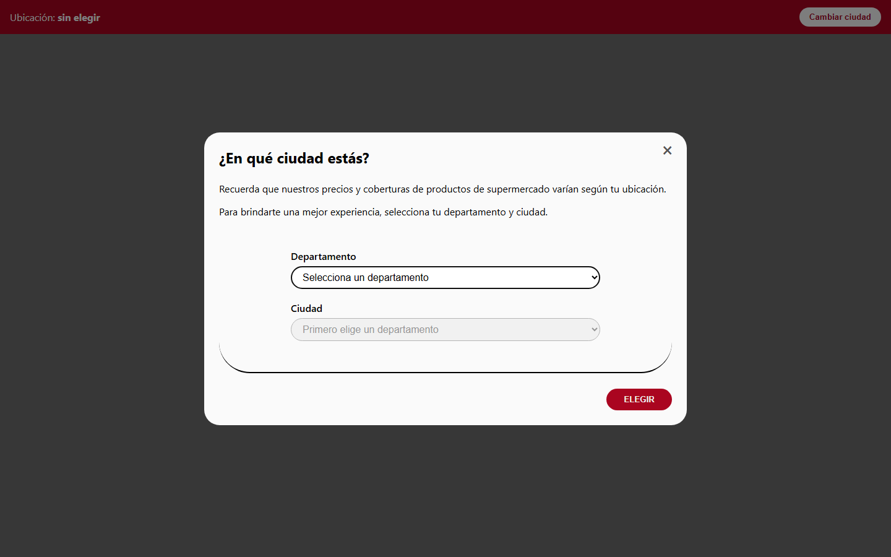

# 🛒 Selector de Ubicación — Modal

**Modal accesible para elegir departamento y ciudad, al estilo de los supermercados en línea**

## ✨ Características

- 📍 **Selects dependientes**: al elegir un departamento solo se muestran sus ciudades
- 🔒 La ciudad queda deshabilitada hasta elegir departamento
- ♿ **Accesible**: `role="dialog"`, `aria-modal`, foco automático y cierre con botón
- 🏷️ La ubicación elegida se muestra en la barra superior y se puede cambiar cuando quieras
- ⚡ JavaScript puro, sin dependencias

Departamentos incluidos: Atlántico, Bolívar y Sucre. Agregar más es tan fácil como editar el objeto `ubicaciones` en `script.js`.

## 🚀 Correr en local

Solo abre `olimpic.html` en el navegador.

---

Hecho por <a href="https://github.com/alejo234506">ALEJO-SQ</a> 🇨🇴

